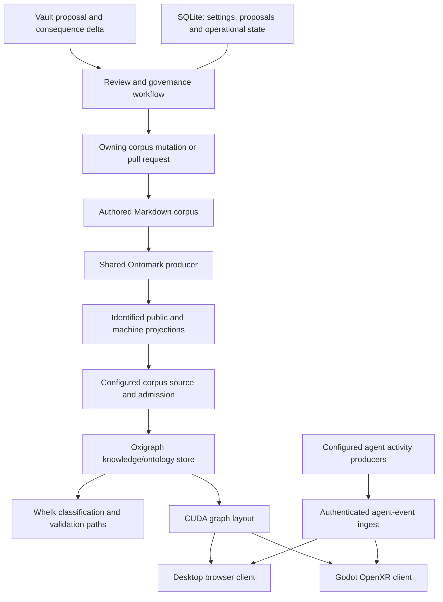

<div align="center">

# VisionClaw

### Explore a knowledge graph, observe agent activity and review proposed changes

**Rust knowledge services, formal ontology checks, CUDA graph layout and desktop/XR clients.**

[Start](#quick-start) · [Architecture](#how-it-works) · [Knowledge workflow](#from-a-corpus-to-a-reviewed-change) · [Codescape](#codescape-is-a-separate-product) · [Status](#working-status) · [Docs](docs/README.md)

</div>

VisionClaw turns an identified Markdown-ontology corpus into a queryable, spatial application. It combines ontology reasoning and governed proposal workflows with GPU graph layout, interactive desktop/XR views and a stream of agent activity. People can inspect the knowledge and the proposed changes; a visualisation is not itself approval.

Use it for ontology exploration, reviewing corpus changes, following agent activity or immersive discussion of a complex domain. The corpus, agent runtime, community review surface and grounding server have separate owners and deployment requirements in the [VisionFlow estate](https://github.com/DreamLab-AI/VisionFlow).

<details>
<summary><strong>Recorded immersive graph walkthrough, September 2026</strong></summary>

https://github.com/user-attachments/assets/ffb75de6-8961-40f7-b73d-847c8ec8bb50

[Local video](docs/assets/media/2026-09-02-immersive-agent-actions.mp4): 109 seconds, no audio. It shows an earlier immersive graph session. It is historical media, not acceptance evidence for today's source, a particular headset model or every agent integration.

</details>

## Quick start

Use the host deployment path. The default feature set includes GPU and ontology support, so follow the [deployment guide](docs/how-to/deployment.md) for CUDA, container-runtime and corpus requirements.

```sh
git clone https://github.com/DreamLab-AI/VisionClaw.git
cd VisionClaw
cp env.example .env
# Configure the deployment, corpus source, access policy and required secrets.
./scripts/launch.sh up dev
```

Run the launcher on the machine that owns the checkout and Docker bind paths. An agent container sharing a host Docker socket must use its authorised host-shell path; launching with container-local paths can mount stale or absent sources.

The current default is local corpus input; GitHub sync is optional and off ([ADR-2115](docs/adr/ADR-2115-github-sync-is-optional-and-off.md)). Read [the corpus contract](docs/VAULT-corpus-format.md) and current deployment configuration to select the source and its required credentials. Private authoring data is not supplied by cloning this application.

| Surface | Development address | Prerequisite |
|---|---|---|
| Desktop client | `http://localhost:3001` | Application ready and corpus configured |
| API and WebSockets | `http://localhost:4000/api` | Backend ready and relevant access policy |
| Codescape through dev proxy | `http://localhost:3001/codescape/` | Opt-in Codescape service |

After a pull or merge, `./scripts/launch.sh redeploy dev` republishes build inputs and rebuilds/restarts the backend in place. Use `rebuild dev` for the launcher’s image/dependency workflow. Read the runbook before changing a running stack; this README refresh did not launch or redeploy it.

## How it works



Oxigraph is the canonical triple store; SQLite holds non-triple state by domain. Neo4j is retired. The backend workspace separates contracts, domain types, ontology/protocol/GPU functionality, adapters and actors; extraction is not complete, so the [baseline](docs/BASELINE-architecture.md) remains the guide to effective ownership.

Desktop and Godot XR are **different clients** consuming shared wire contracts. Compatibility of position records reduces duplicated protocol work; it does not establish identical interaction or device acceptance. [GPU/wire ABI](docs/GPU-wire-abi.md), [protocol registry](docs/PROTOCOL-registry.md) and [XR architecture](docs/XR-client.md) define their boundaries.

## From a corpus to a reviewed change

1. Configure a corpus source and load the intended generation/projection. Markdown/frontmatter defines the authored ontology; runtime stores are derived application state.
2. Query or explore the graph. GPU position and graph topology help inspection; layout does not prove a relationship or an assertion is correct.
3. Prepare a change through the supported proposal path. Integrity checks, reasoning and authorisation have different purposes and produce different outcomes.
4. Review the proposed bytes and consequences. The configured broker/forum path carries a signed decision; a permission decision is not a receipt that the mutation was applied.
5. Apply through the owning workflow and observe its receipt or pull-request lifecycle. Merge observation requires the relevant credentials and polling configuration; creating a PR does not mean its contents are already in canon.

The current elevation queue is a specific ontology workflow, not a universal agent-control system. [Insight migration](docs/explanation/insight-migration-loop.md), [authority chain](docs/IDENTITY-authority-chain.md) and [data authority/erasure](docs/DATA-authority-erasure.md) explain how identity, policy and lifecycle constrain it.

<details>
<summary><strong>Certificates and proposal consequences</strong></summary>

`vault certify` records derivations under the supported RDFS rule table and compares the named subclass closure with Whelk's result. An independent `oo-cert` checker can recheck the certificate. The certificate warrants derivation under that rule table, not factual truth or arbitrary OWL 2 EL entailment.

`vault propose` can attach a consequence delta: named consequences added or lost, examples and a count of blank-node-bearing consequences not compared. A conservative result over the named closure must not be read as proof that every semantic effect was compared.

The 20 October follow-up replaces a private certificate engine with the shared [`rdfs-certificate`](https://github.com/DreamLab-AI/ontomark/tree/main/crates/rdfs-certificate) crate. The [source adapter](crates/vault/src/certificate.rs), [proposal implementation](crates/vault/src/propose.rs) and [ADR-2147](docs/adr/ADR-2147-inferences-carry-a-re-checkable-certificate-and-proposals-carry-a-consequence-delta.md) specify the boundary and dated checker evidence. The client includes consequence display; workflow configuration invokes certification on its applicable build path. Neither fact proves that every served generation has been rechecked or that every deployment runs the new code.

</details>

<details>
<summary><strong>Agent activity, provenance and governance events</strong></summary>

Agent activity enters through `/wss/agent-events` and can be rendered as beams or other transient cues. The position protocol uses the frozen 52-byte V3 record in V5 envelopes; agent actions use the separate `0x23` opcode. See [the binary protocol](docs/reference/binary-protocol.md) and [agent-beam driver](docs/how-to/operations/agent-beams-dev-driver.md).

The Agent Control Surface uses kinds 31400–31405. Response admission depends on the forum's role/delegation policy and the consumer's checks, not a blanket assertion that only one UI or key can ever sign. The application must preserve the effective policy tier and record whether an approved action happened.

Provenance records and their query endpoints make attribution inspectable on implemented paths. Fail-open emission, incomplete receipts and external stores have their own limits; do not infer “every write is durably proven” from a successful mutation response. Read [security profiles](docs/SECURITY-profiles.md) and the [authority documents](docs/IDENTITY-authority-chain.md).

</details>

## Codescape is a separate product

[Codescape](https://github.com/DreamLab-AI/codescape) visualises source code and collaboration rather than the knowledge corpus. This repository mounts it as the `codescape/` submodule and supplies the host compose/proxy contract. Codescape has its own Cargo workspace, lockfile, data directory, client and acceptance evidence.

Its tested build boundary excludes knowledge stores; its shared estate dependency is the published `visionclaw-wire` record, while CUDA PTX arrives as a runtime artefact. The standalone Codescape checkout may be newer than this repository's pinned submodule; compare revisions when evaluating a feature.

```sh
# From this VisionClaw checkout, on the deployment host:
git submodule update --init codescape
./scripts/launch.sh up dev    # asks which optional sidecars to start; tick Codescape
```

The launcher remembers the choice (`.launch-sidecars`, gitignored) and offers it as the default next time. For a
non-interactive start use `./scripts/launch.sh up dev --sidecars=codescape` (or `--no-prompt` to reuse last time's
choice). The old `CODESCAPE=1` environment switch is gone; the menu and `--sidecars` are the only inputs.

The direct client port is loopback-only in the recorded deployment; hook ingest stays on the private container network. Codescape's main-port authentication remains open in its current implementation and `--require-auth` refuses startup. The development proxy is not production authentication. Microphone capture needs a secure browser context. Read [the extraction decision](docs/adr/ADR-2143-codescape-section-separate-workspace-and-port.md) and Codescape's own README before enabling it.

## Working status

**Source reviewed 21 October 2026 at `e2d4e2cc1`.** Recent commits add the consequence display/certification workflow and shared certificate crate. Source presence, tests at a revision, running services and device acceptance are separate evidence classes.

| Area | Established source/evidence | Boundary |
|---|---|---|
| Ontology and storage | Oxigraph/SQLite application, Whelk and validation paths | Supported reasoning profile and loaded generation determine semantics |
| Corpus compilation | Shared Ontomark ownership; local input and optional GitHub source | No private corpus is bundled; consumers must align generation and projection |
| Certificates | Shared RDFS certificate crate and dated independent-checker run | Named closure/rule scope, not general proof of all consequences |
| Review/elevation | Case queue, rationale checks, recovery and merge polling exist | [ADR-2110](docs/adr/ADR-2110-augmentation-conditions-visionclaw-substrate.md) retains unresolved human-session and task-property acceptance boundaries |
| GPU and XR | Source, historical desktop/OpenXR runs and wire contracts | No fresh GPU, VIVE or Quest acceptance was run for this README |
| Activity | Event ingest and rendering paths | Producer hooks and current image activation are independently configured |
| Gluon attraction | Designed agent-to-target force | Do not confuse the visible beam with an implemented attractive-force edge |

The [work register](docs/TODO-unified.md), [known issues](docs/KNOWN_ISSUES.md) and governing documents contain the detailed outstanding work. Old class/kernel counts, September defect totals and whole-estate memory totals are not current application acceptance evidence.

## Where it sits in VisionFlow

[VisionFlow](https://github.com/DreamLab-AI/VisionFlow) owns the ecosystem map and compatibility records. [Ontomark](https://github.com/DreamLab-AI/ontomark) owns shared compilation; [knowledgeGraph](https://github.com/DreamLab-AI/knowledgeGraph) distributes the public corpus; [Loom](https://github.com/DreamLab-AI/loom) serves grounding. [Agentbox](https://github.com/DreamLab-AI/agentbox) runs agents; [the forum kit](https://github.com/DreamLab-AI/nostr-rust-forum) supplies communication/review contracts; [solid-pod-rs](https://github.com/DreamLab-AI/solid-pod-rs) supplies tier-specific pod primitives. Shared identifiers do not make these one runtime or one licence scope.

## Documentation, contribution and licence

[Docs hub](docs/README.md) · [System overview](docs/explanation/system-overview.md) · [Vault contract](docs/VAULT-corpus-format.md) · [API](docs/reference/rest-api.md) · [Deployment](docs/how-to/deployment.md) · [Decision ledger](docs/adr/README.md)

Read [CONTRIBUTING](docs/CONTRIBUTING.md) and the relevant governing document before changing authority, storage or the frozen wire. Root application code is **AGPL-3.0-only** ([LICENSE](LICENSE)); extracted crates and submodules have their own terms. The in-tree MPL proposal is not the operative root licence. [MAINTAINERS.md](MAINTAINERS.md) records maintainers and upstream credit, including Melvin Carvalho's Solid/JSS lineage.
