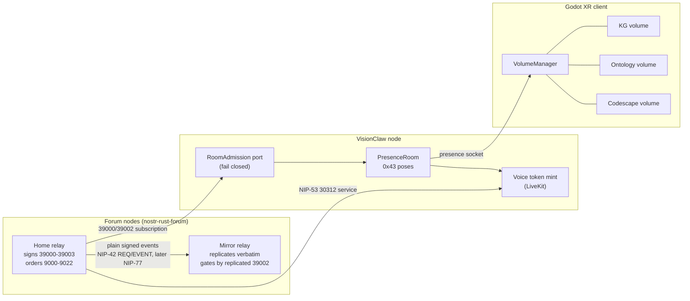

# Spatial rooms: NIP-29 spaces across forum nodes, rendered in VisionClaw volumes

Date: 2026-10-30 · Status: proposed plan · Owner: jjohare
Research: [`research/`](research/) (five worker reports, swarm `swarm-1793348706856-n5upgb`, sources read at obelisk-app commits listed in §7).
Decision records: forum ADR-2030, ADR-2031, ADR-2032 (`nostr-rust-forum/docs/adr`); VisionClaw ADR-2157, ADR-2158, ADR-2159, ADR-2160, ADR-2161 (`docs/adr`); agentbox ADR-2162 (`agentbox/docs/adr`).

## 1. Thesis and what changed on inspection

The thesis comes from obelisk-sky (sky.obelisk.ar): **a NIP-29 group is a place.** You walk to a room, its chat and call are scoped to where you stand, and the relay is the world. Our estate already has the parts: the forum relay (`nostr-rust-forum`), multi-relay mesh (`nostr-bbs-mesh`), did:nostr identity, an authoritative XR presence crate (`visionclaw-xr-presence`, 0x43), and a Godot OpenXR client.

The brief was to port the AGPL obelisk code to Rust. Inspection says not to:

| Source | Licence | Finding | Route |
|---|---|---|---|
| `obelisk-relay` (Rust) | AGPL-3.0-only | Single-node NIP-29 relay. No federation (roadmap line only). Engine bound to LMDB and git-only `relay_builder`; cannot run on Cloudflare Workers. No `previous` timeline refs. | Implement NIP-29 from the spec (no wholesale engine port); selected pieces may be lifted with attribution under §2 |
| `obelisk` (TS client) | AGPL-3.0-only | Multi-relay client, WoT filtering policy | Ideas (WoT `minPaths`, fail-closed on incomplete graph) |
| `obelisk-sky` (TS, three.js) | **none** (all rights reserved) | The spatial UX. Placement is computed per client and is not canonical; motion is relay-wide and barely validated | Ideas and wire facts only |
| `obelisk-sfu`, `-apps`, `-design` | **none** | Nostr-challenge auth for an SFU, SFU adverts, iframe app sandbox | Ideas only |
| `obelisk-agents` | MIT declared in `package.json`, no LICENSE file | NIP-29 bot recipe | Code may be lifted with its MIT notice (§2); the missing LICENSE file is recorded in the `NOTICE` |
| `obelisk-menhir` (Rust) | MIT | Rebuild of relay concepts; little to lift | Nothing taken |

Porting `obelisk-relay` is licence-compatible (§2), but little of it is worth porting: its engine is bound to LMDB and to git-only dependencies, and it has no federation. What is worth taking is the pattern, and where obelisk used private event kinds, published NIPs already cover the need: **NIP-53 kind 30312 "Interactive Room"** (a space with a `service` URL, open/private/closed status and Host/Moderator/Speaker roles) and **kind 10312 "Room Presence"**. This plan allocates **no new event kinds**.

## 2. Licence and provenance policy (applies to every phase)

0. **Ownership (operator, 2026-10-30).** The operator owns the copyright of the whole AGPL-3.0 estate: VisionClaw, nostr-rust-forum, agentbox, solid-pod-rs and Codescape. So AGPL binds our own code only as a policy choice, and the operator may relicense or dual-license any part they wrote. Obelisk-app is *not* ours: the owner has no rights on that GitHub org, whose members are a separate team. Its licences bind us.
1. **obelisk-relay (AGPL-3.0-only) may be ported** into our AGPL crates, because the licences match. A ported file keeps the upstream copyright notice (Daniel Cadenas / verse-pbc) and records its origin in a `NOTICE`. Porting is permitted, but it is not the default: its engine is bound to LMDB, `nostr-lmdb` and git-only verse-pbc crates, and it has no federation. So the group engine is still written against the NIP-29 text. Individual pieces may be lifted with attribution, where they help: visibility edge cases, invite-code policy, WoT BFS. Obelisk's MIT `package.json` code (obelisk-agents, menhir) may be lifted with its MIT notice.
2. **Provenance still matters, for one reason: relicensing.** Code derived from obelisk-relay can never be released under a permissive licence, because we don't hold its copyright. Code we wrote ourselves can be, at the owner's choice. Every file therefore records whether it is *own* or *derived (obelisk-relay)*. The research read set (2026-10-30: obelisk-relay `src/group.rs`, `groups.rs`, `wot*.rs`, `relay_invites.rs`, obelisk `src/services/wot/*`, plus the unlicensed repos) is kept so that a later permissive release of the group crate can be judged. The new group crate starts AGPL-3.0-only.
3. **Repos with no licence stay ideas-only.** That covers obelisk-sky, obelisk-sfu, obelisk-apps and obelisk-design: all rights are reserved, so we take protocol facts (kind numbers, tag shapes) and patterns, never code, assets or copy. Asking the obelisk team for a licence is the only way to change this.
4. **Published permissive crates stay clean of AGPL.** `nostr-bbs-core` and `visionclaw-wire` are MIT OR Apache-2.0 on crates.io and never depend on an AGPL crate or contain derived code. A CI check asserts this with `cargo tree` (forum P0). Our own AGPL code could go into them only by an explicit owner relicensing decision; derived code never can.
5. Interop with Obelisk clients happens only through standard NIP-29 events. We do not adopt their private kinds (20390, 31313, 31314, 25050–25052) or 30078 d-tags.
6. **AGPL §13.** For our own code the source offer is policy, not obligation. It becomes an obligation owed to obelisk-relay's holders for any deployment that contains derived code. Either way, the forum client shows a prominent source link in its footer and about page, serving Corresponding Source for the exact deployed commit. The NIP-11 `nostr_bbs` block (`source_url`, `licence`, commit) supplements the link. The test is source-to-deployment correspondence; field presence alone does not pass it.

## 3. Domain model

- **Space** = a NIP-29 group. Identity is `(home relay pubkey, group id)`, written `host'id` for NIP-29 interop but pinned by pubkey, so a host rename does not change the space and a fork (new home key) is a different space.
- **Home relay** signs the group's state (39000–39003) and orders moderation. **Mirror relays** replicate that state verbatim and enforce it locally.
- **Room** (VisionClaw presence) = the live co-presence session for a space on a VisionClaw node. The room id is minted from the space identity, never typed in.
- **Volume** = how one client presents content on its own device: a bounded, runtime-placeable box. A graph is a volume's content. **A space is not a volume**; a space may *describe* the volumes it shows, and each client lays them out locally.
- **Call** = the voice/media session for a space, discovered through the home relay's NIP-53 30312 event.

## 4. Decisions by repository

### Forum (`nostr-rust-forum`)

**ADR-2030: a NIP-29 group engine, written from the spec.**
- New crate `nostr-bbs-groups` (AGPL-3.0-only, pure, no I/O, wasm32, `?Send`). State is a fold over 9000–9022 in the home's admission order (ADR-2031 D2), never `(created_at, id)`. It produces relay-signed 39000–39003. It implements the visibility flags `private`/`closed`/`hidden`/`restricted`, 9021/9022 join and leave, 9009 invite codes, and the `previous` timeline check. The relay worker consumes it.
- **Membership authority, one store:** a group backed by a zone takes its members from the zone cohort (ADR-2014 lifecycle). The relay issues 9000/9001 itself when the cohort changes. Every membership-changing event on that group (9000, 9001, 9005, 9009, 9021, 9022) is per-event either refused as a direct group mutation or routed through the cohort authority and re-projected; it is never applied to the group directly, and a lagging projection denies access. A standalone group's membership is its own admitted NIP-29 event stream. The home signs the authoritative projection in both cases. A group never feeds a zone.
- **Kind 9 dialect (amends ADR-2029):** in the `forum` profile, NIP-29 groups are available and kind 9 carries `h`; channels stay kind 42, so nothing collides. In the `room` profile (Anagram kind 9 with `a`), NIP-29 groups are disabled in v1 and the relay rejects `h`-tagged kind 9. This keeps the D1 dialect pin meaningful.
- **Encryption boundary (with ADR-2028):** NIP-29 spaces are relay-gated. End-to-end private groups remain NIP-171 zones. XR v1 does not depend on E2E.
- **Phase-0 defects, independent of the rest:**
  - drop `29` from NIP-11 `supported_nips` until the read and write gate exists. Today kind 9 is world-readable and 39000 is client-spoofable (`nip_handlers.rs:1298-1310`, `nip11.rs:207`);
  - delete or fix the legacy `create_group_metadata`, which tags kind 39000 with `h` instead of `d` (`nostr-bbs-core/src/groups.rs:137-149`; `build_group_metadata` at `:254` is correct);
  - add the `cargo tree` AGPL guard.

**ADR-2031: federated groups with one home relay and verbatim mirrors.**
- Home pinned by the relay's own key, NIP-11 `self` (not `pubkey`, which NIP-11 defines as the admin contact; the relay worker has no signing key today, so custody is a prerequisite); mirrors verify every 39000–39003 is signed by the pinned key and store it verbatim, replacing by `d`.
- Mirrors accept kind 9 from members in the replicated 39002 and forward it to the home. Moderation 9000–9022 is accepted only at the home; mirrors forward it. The home is the order authority.
- **Transport:** relay-to-relay plain signed events over NIP-42-authenticated `REQ`/`EVENT`, reusing `nostr-bbs-mesh`'s `PeerManager`, allowlists and `SeenIds`. Catch-up via NIP-77 negentropy comes in phase 2. Not the gift-wrapped IS-Envelope path, which is point-to-point messaging.
- **Prerequisites:**
  - replacement must order 3900x by (`rev`, `created_at`) with equivocation rejected (a D1 schema migration adding a `rev` column), the same revision-ordered storage covers 30312 and kind 30078 only in the `visionclaw:dataspace:*` d-tag namespace (final audit #9), so a relay never discards a higher-`rev` event for a lower one; all other replaceable kinds keep NIP-01: late older rejected, same-second ties by lowest id (`storage.rs:97-139`);
  - the dedup index is persisted (not in-memory `SeenIds` lost on DO eviction);
  - the outbound Cloudflare `PeerConnector` is implemented.
- **Move is deferred out of v1.** A safe move needs an authenticated two-home handover: a frozen old revision, a destination snapshot, re-admission at the destination, and revocation at cutover. That is a later ADR. **Fork:** a new home key is a new space with freshly authorised membership; no authority is copied.
- **Ordering and freshness.** The home applies moderation in its own admission order, authorised against the state current at admission. Every state change raises a monotonic `["rev"]`; `created_at` is honest wall-clock time, never bumped. The home re-signs 39002 every 30 s as a heartbeat (same `rev`, identical content, later `created_at`), and only while its projection is coherent. Mirrors and VisionClaw order by (`rev`, `created_at`), keep a persisted watermark, and treat a snapshot as stale beyond L + S = 70 s; the end-to-end revocation bound is D = 90 s (rounds 2-5, `AUDIT-DECISIONS.md`).
- **Pinning:** the operator pins the home `self` key out of band in config. It is never taken trust-on-first-use from NIP-11.
- NIP-11 `nostr_bbs.federation` lists homed and mirrored groups.
- Rationale draws on archived ADR-073/074/075/080 (mesh topology, did:nostr canonicalisation, IS-Envelope, deployment topology D2). Those are cited as rationale only; this ADR restates what it relies on.

**ADR-2032: a space is a NIP-29 group with a relay-signed spatial descriptor and a NIP-53 interactive room.**
- **Descriptor:** extra tags on the home-relay-signed 39000. `["space","1"]`, `["place", x, y, z]` (metres, in the node's world frame), `["extent", w, h, d]`, optional `["scene", <uri>]`, and `["volume", <content-ref>, <bounds-hint>]` per volume it shows. Because the home relay signs 39000, placement is canonical and operator-authored, which fixes obelisk-sky's per-client layout. Other NIP-29 clients ignore unknown tags. When absent, default placement is a pure function of `(home pubkey, group id)`.
- **Media:** the home relay publishes one NIP-53 kind 30312 per space with a voice service:
  - `d` = group id;
  - `status` derived from the group flags;
  - `service` = the call endpoint;
  - `p` Host entries = the group admins (39001).
- **Coarse presence:** "who is in which space" is NIP-53 kind 10312 with an `a` tag to the 30312. Fine-grained poses stay on VisionClaw 0x43.
- **Seat/spot claims:** NIP-78 kind 30078 with d-tag `visionflow:claim:<home-key-hex>:<group>:<spot>` (home key in canonical lowercase hex), NIP-40 expiry 90 s. The earliest `created_at` wins, then the lowest id.
- **Out of scope**, noted as a follow-up: in-world apps. The obelisk-apps sandbox pattern (opaque iframe origin, `connect-src 'none'`, host-built signed events, apps never see a signer) is the model to evaluate.

### VisionClaw (`project`)

**ADR-2157: presence rooms are bound to NIP-29 spaces and admitted by membership.**
- **Room id:** a new URN form `urn:visionclaw:room:nip29-<32 hex>`, where the hex is SHA-256 truncated to 128 bits over a length-prefixed `(home pubkey, group id)`. It is minted only by a typed `room_from_group()`. The existing `sha256-12` form stays parseable for unbound rooms. The 128-bit length addresses the 48-bit collision risk across a federated set (IDENTIFIER-taxonomy).
- **Fork:** a changed authoritative identity (a different home key) gives a new room with fresh admission; a hostname or endpoint change under the same pinned key is not a fork. Move is deferred with the forum ADR. A server-side registry maps each `nip29-` URN to (pinned home key, group id), and only `room_from_group()` fills it. Unknown URNs are rejected, because the parser alone is not trusted.
- **Revocation:** a snapshot older than L + S = 70 s is inadmissible, which closes existing sessions (at the next check, within C = 10 s) as well as blocking new joins. Admission runs as check, then register, then re-check. A removal kicks the member's presence and calls LiveKit `RemoveParticipant`. Token TTL is at most L = 60 s, and the 25 s grace covers **voluntary** disconnects only, never a removal, ban, kick or stale-authority closure. The end-to-end guarantee is D = 90 s for presence and dataspace streams; voice is the weaker D_voice = 2L + 2S + C = 150 s (an issued token cannot be revoked), and a LiveKit API partition is a documented exception needing operator sign-off.
- **Admission:** a `RoomAdmission` port beside `IdentityVerifier`, called in `handle_auth` before the actor spawns (`presence_handler.rs:~273-300`). The NIP-29 adapter holds a persistent NIP-42-authenticated subscription to the home relay's 39000/39002 (an upgrade of `nostr_bridge.rs`, which today connects per event without AUTH). It **fails closed** on unknown group, unreachable relay, or cache older than its TTL. The room has a member cap.
- **Kick:** removal (9001) or ban sends a `room_kicked` text frame and closes the socket. A `room_meta` text frame carries 39000 name, about and picture. Both go in PROTOCOL-registry with a new presence text-frame table. No binary opcode is added and the frozen `visionclaw-wire` does not change.
- **Data class:** the membership cache is a disposable derived projection (DATA-authority-erasure).
- **Scope:** ADR-2013 defers enterprise identity federation (OIDC/SAML/LDAP/SCIM) and NIP-26 delegation; it says nothing about relay federation. This stays inside it because the principal is still the user's own key, 39002 is an authorisation input not an identity source, and the bridge's NIP-42 AUTH proves only the bridge.
- **Codescape:** stays out of v1 (its auth is open until its P6). Any shared room-binding code reaches Codescape only through crates.io (isolation I9/I10).

**ADR-2158: the XR client presents content in spatial volumes with an OpenXR-shaped contract, emulated until the runtime provides it.**
- **Contract:** a GDScript `SpatialVolume` contract mirrors `XR_EXT_spatial_container` (EXT #811, OpenXR SDK 1.1.63, 2026-09-01): bounds, bounds mode `bounded`/`immersive`, visible, interactable, closed. Changes are requests answered by granted/denied signals, and bounds changes arrive as events.
- **Implementations:** `EmulatedVolume` works everywhere today. `NativeMainVolume` adapts Godot's `OpenXRSpatialContainerExtension` only on Godot ≥ 4.8 with a runtime that advertises the extension. Today that is Android XR only; SteamVR's `vrclient.so` on the HP has no `XR_EXT_spatial_*` strings, and Monado and Quest have no support. Godot exposes one main container per app, so at most one volume is native. The adapter lives in GDScript because gdext has no 4.8 API binding.
- **Trial E3 (the operator's request):** three emulated volumes.
  - (a) the knowledge graph and (b) the ontology graph, split by `NodeKind` from the one VisionClaw stream;
  - (c) the Codescape estate graph, from a second connection (ADR-2159);
  - the memory cloud stays world furniture.
- **Fit:** a volume scales uniformly by `min_i(bounds_i / content_i)` over the axes, ignoring any axis whose content extent is below 1e-6 (the smallest bounds axis alone does not decide it), centres at the volume origin, restores 1:1 in immersive, and un-latches and eases on `bounds_changed`.
- **Cross-volume edges (decided):** optional and switchable. `xr.cross_volume_links` defaults off and toggles at runtime; it covers knowledge↔ontology bridges and federated data-space links.
- **Amends ADR-2135:** the tri-layout triangle becomes the default *arrangement* of volumes rather than a per-node fold. Metres is the target presentation unit; the graph-unit conversion, vertex allocation and yaw handling are unresolved and need an owner before E3 (ADR-2158 Consequences). A user's move of a volume overrides it. E3 itself fires ADR-2135's "fourth body" review trigger (three volumes plus the memory cloud), and this ADR answers it.
- **Later (P6), not part of E3:**
  - native arm N1;
  - per-device persistence of the volume arrangement keyed by room (`XR_EXT_spatial_persistence`);
  - co-located alignment to a shared marker (`XR_EXT_spatial_marker_tracking`). No EXT for anchor sharing exists; vendor extensions are not adopted.

**ADR-2159: the XR client holds one backend connection per content source.**
- Replace the exclusive `_switch_backend` (`graph_scene.gd:909-927`) with a `BackendConnection` per source: its own `BinaryProtocolClient`, ack sequence (ADR-2141), render store, `BackendCaps` and palette, bound to the volumes it feeds.
- Capability gating moves from global to per volume. For example, drag works in the KG volume and is refused locally, with a HUD notice, in the Codescape volume.
- **Presence:** one presence socket per joined room (in the trial, the existing authenticated VisionClaw presence room, not a space-bound one; bound-room admission applies after the later ADR-2157 rollout); Codescape's presence shim is not joined in E3.
- **Frame budget:** the frame budget (100,000 triangles and 50 draw calls, `xr-client/rust/src/frame_budget.rs`) is shared and split per visible volume; a hidden volume stops packing.
- Verify that two `BinaryProtocolClient` instances can share the gdext tokio runtime before building on it.

**ADR-2160: a space's call is a LiveKit room admitted by the presence handshake, spatialised on the client. DEFERRED (operator, 2026-10-30): voice is not allowed; the design below is kept for later and nothing of it is built.**
- **Call identity and token:** the call's LiveKit room name derives from the room URN. VisionClaw mints the LiveKit token only after the presence handshake and `RoomAdmission` have passed; there is no second credential path.
- **Discovery:** through the home relay's NIP-53 30312 `service` tag.
- **Spatialisation:** HRTF, client-side, from 0x43 poses. This completes `SpatialVoiceRouter`, which today does routing maths with no media backend.
- **Leaving:** a **voluntary** leave starts a 25 s grace timer, persisted across restarts, after which VisionClaw calls `RemoveParticipant`. Removal, ban, kick and stale-authority closure get no grace and an immediate removal attempt. Token expiry is never the enforcement deadline.
- **Signalling security:** SDP and ICE never travel as cleartext relay events.
- **Server choice:** LiveKit stays the SFU. Rust SFUs (`str0m`, MIT OR Apache-2.0) are noted and not chosen.

### Node-to-node data-space federation (added 2026-10-30, operator scope change)

There are two federations, and they stay separate.

- **Authority federation** (forum ADR-2031) replicates *who may enter a space*: home-signed NIP-29 state. Stale authority is a security failure, so it fails closed.
- **Data-space federation** (VisionClaw ADR-2161, agentbox ADR-2162) lets node B's graph content appear in node A's scene as a linked volume. Stale content is a freshness problem, not a security one; access to it is still decided server-side by the node that owns it.

Decisions (detail and audit closure in ADR-2161, ADR-2162 and `AUDIT-DECISIONS.md` C5–C9):

- **A data space** is a named, server-side projection of one node's graph: a selector over its content plus an acl of `public`, `dids:<list>` or `space:<nip29-room-urn>` (the exact registered room-URN form, resolved through ADR-2157's registry). It is named `urn:visionclaw:dataspace:<node-key-hex>:<space-id>`, so the URN carries its own authority.
- **One node federation key per node**, held by the agentbox mesh service behind a local signing socket. VisionClaw holds no federation key. The key names data spaces, signs catalogues, authenticates envelopes and identifies the node to peers. Rotation is a new identity.
- **Peers are pinned by the operator** in `[mesh]`, projected read-only to VisionClaw. Nothing is learnt on first use. Scope is one operator's nodes; cross-operator peering stays parked under agentbox ADR-2025 and ADR-2101.
- **Discovery** is a signed, replaceable catalogue (kind 30078 with `rev`). Beyond the contract fields (`d`, `rev`, `endpoint` or withdrawal `status`, id, signature), public entries carry only the space id and acl kind as descriptive metadata. An active entry's endpoint must equal the configured peer endpoint exactly; a valid withdrawal carries no endpoint. The catalogue d-tag namespace `visionclaw:dataspace:*` is stored revision-ordered.
- **Content never travels over the mesh.** The viewer's XR client opens a direct connection to the owning node, one per (node, data space), authenticated as the viewer with NIP-98. The owning node filters every output by selector ∩ object visibility ∩ acl, refuses mutations, and re-checks access at least every 10 s. This reuses ADR-2159's per-source connection layer.
- **Links between data spaces** are expressed by URN, never by wire id (wire ids are per-server and ephemeral). A link is drawn only when the viewer may see both ends; otherwise nothing is drawn.
- **Retraction and erasure.** Only the URN's own key may retract it. An asserting node's own link record is primary local data (its 7-day lease means re-announce); a received copy or viewer render state is a disposable foreign reference, a 7-day lease renewed by the catalogue, so an offline consumer drops it even if a retraction is lost. Tombstones block resurrection. Remote content is render-only: never persisted durably, imported or backed up; the viewer's session-memory render store is permitted. Control envelopes are exactly `dataspace_announce`, `link_notice` and `retraction`.
- **Not in v1:** cross-operator federation, remote physics (the owning node's acknowledged position stream is consumed as is), ontology alignment across nodes, and migrating links on key rotation.

## 5. Phases

| Phase | Repo | Work | Depends on |
|---|---|---|---|
| P0 | forum | Stop advertising NIP-29; fix the 39000 builder; `cargo tree` AGPL guard; replacement ordered by `rev` (D1 schema migration, ADR-2031 D7) | none |
| P1 | forum | `nostr-bbs-groups` engine + relay read/write gate, single node; zone→group projection with the coherence test and `proj` tag; one multiplexed DO alarm (re-sign 30 s, coherence re-check) | P0 |
| P2 | VisionClaw | `room_from_group`, `RoomAdmission` (fail closed), persistent NIP-42 bridge subscription, `room_meta`/`room_kicked`; per-room member cap (new code, default 32, configurable); move the XR default room off `sha256-12-deadbeefcafe` to a bound room before `bound_only` is set true | P1 |
| P3-pre | VisionClaw xr-client | ADR-2159 two-client tokio/gdext preflight (decision 5), before any of P3a/P3b is built | none |
| P3b | VisionClaw xr-client | Concurrent backends (`BackendConnection` per source); Codescape volume (E3 complete) | P3-pre |
| P3a | VisionClaw xr-client | `SpatialVolume` contract + `EmulatedVolume`; KG and ontology volumes (E3 first half) | P3-pre, and the backend capability of P3b it needs (ADR-2158 depends on ADR-2159) |
| P4 | forum | Home/mirror federation; persisted dedup; `PeerConnector`; NIP-77 catch-up | P1 |
| P5 | both | Space descriptor tags; NIP-53 10312 coarse presence | P2, P4 |
| P5v | both | **Deferred (no voice for now):** NIP-53 30312 publisher; spatial voice; LiveKit server-API client and 10 s reconciler (ADR-2160 D6) | operator lifts deferral; P5 |
| P6 | VisionClaw | Native container N1 (Godot 4.8 stable + Android XR); arrangement persistence; marker colocation | P3, Godot 4.8 |
| P7a | agentbox | `[mesh]` reader, pinned peers, node federation key, `dataspace` kind-map row (ADR-2162) | none |
| P7b | VisionClaw | Federated-read connection mode (server-side stream contract), catalogue, data-space volumes, URN links, retraction and lease handling (ADR-2161 `public`/`dids`) | P7a, ADR-2159 |
| P7c | VisionClaw | `space:` data spaces, admitted through `RoomAdmission` | P7b, P2 (ADR-2157), forum P4 |

P3 does not wait on the forum: the trial runs on today's VisionClaw and Codescape backends. Within P3 the two-client preflight comes first, then the connection layer, then the volumes that consume it. This is implementation sequencing; activation is separate.

### 5a. Activation order

Activation order is the per-ADR "Activation prerequisites" sections (audit round 2, C9); the table above is build order. `depends_on` in ADR frontmatter lists code dependencies only. The staged order, which later documents cite as PLAN §5a:

1. agentbox ADR-2162;
2. VisionClaw ADR-2159, then ADR-2161 (`public`, `dids`);
3. forum ADR-2030, then ADR-2031;
4. VisionClaw ADR-2157, then ADR-2161 (`space:`);
5. **Deferred:** VisionClaw ADR-2160 (voice). Not activated until the operator lifts the deferral. Its prerequisite, the validated home-signed 30312 publisher (forum ADR-2032 D4), goes live with the forum chain at step 3. The 30312 publisher is a voice prerequisite only, not needed for `public`/`dids` federation.

The volume work (ADR-2158) can proceed once ADR-2159's two-client test has passed.

## 6. Expectations (EDD), including what must not happen

| # | Expectation | Evidence |
|---|---|---|
| E1 | A non-member's kind 9 to a `closed` group is rejected at the home **and** at every mirror | Relay integration test, two-node fixture |
| E2 | A mirror never stores a 39000–39003 not signed by the pinned home key, and never emits one of its own | Property test over forged/replayed state |
| E3 | Every state change raises `rev`; a heartbeat repeats `rev` with identical content and a later `created_at`; a lower-`rev`, replayed or equivocating (equal `rev`, different content) 39002 never replaces the stored one at a mirror or in VisionClaw (persisted watermark); moderation applies in admission order | Storage unit test + heartbeat/equivocation tests + replay-after-restart test |
| E4 | A DID absent from 39002 cannot join the presence room, **including when the home relay is unreachable or the snapshot is older than L + S = 70 s**; a removal racing a join kicks immediately | Presence handler test with a dead relay stub; check-register-recheck race test |
| E5 | A removal (9001 or zone-cohort removal) ends presence within D = 90 s (rejoin refused) and voice within D_voice = 2L + 2S + C = 150 s (a rejoin with a still-valid token is removed within C until then; after it, rejoin is impossible). Presence and dataspace streams close across a partition of the home; voice requires a reachable LiveKit API, with the documented recovery and operator sign-off | Two-node integration test + LiveKit `RemoveParticipant` stub covering kick, reconciler, partition, reconnect, restart and token reuse |
| E5b | Every membership mutation path for a zone-backed group (9000/9001/9005/9009/9021/9022) is refused or routed to the cohort authority; projection lag denies access | Relay test per path + projection-failure test |
| E6 | `cargo tree -p nostr-bbs-core` and `-p visionclaw-wire` contain no AGPL crate | CI step |
| E7 | No drawn node centre lies outside its volume's box; at most one frame of excursion during a resize | Debug assert + GUT fit tests |
| E8 | 90 Hz on the VIVE with KG + ontology + Codescape (~4.4k nodes) volumes visible | Headset session log against `XR-client.md` budget tables |
| E9 | Codescape `nodeDrag` is refused locally and never sent | GUT ray fixtures + socket capture |
| E10 | No LiveKit token is minted without a passing `RoomAdmission`, never for an unbound or unregistered room, and never with an `iss` (per-SFU API key) other than the configured SFU's, a grant beyond one room, or a TTL above L = 60 s (LiveKit enforces no audience claim) | Handler test |
| E11 | Two clients with different histories place the same space at the same coordinates | Pure-function test over the descriptor default |
| E12 | The forum client shows a prominent source link that serves the exact deployed commit unauthenticated (AGPL §13) | Deploy smoke test comparing served source to the deployed commit |

**Activation gates (feature-specific, following §5a; not one universal list).** A feature is advertised or switched on when its own gate passes, not when a downstream feature exists. Where a number is given (D = 90 s, D_voice = 150 s), it is the measured deadline in the adversarial outage tests, not a hope.

| Feature | Gate |
|---|---|
| `public`/`dids` data-space federation (ADR-2161) | Its own EDD expectations D1 to D7 (ADR-2161), the agentbox ADR-2162 tests and ADR-2159's two-client test plus E8. Needs no forum test. |
| Restoring NIP-29 in NIP-11, and mirroring (forum ADR-2030, ADR-2031) | E1, E2, E3, E5b, E6, E12 and the ADR-2030 coherence check. Does not need a running voice service or bound presence rooms. |
| Bound presence rooms (ADR-2157) | The forum gate above, plus E4, the D = 90 s presence assertion and the registry golden vector. |
| `space:` data spaces (ADR-2161) | `public`/`dids` gate, the bound-presence gate and E5 for dataspace streams. |
| Space calls (ADR-2160), **deferred** | All of the above `space:` prerequisites, the forum 30312 publisher (ADR-2032 D4), E5 (voice part), E10 and the LiveKit partition sign-off. |
| XR trial E3 (ADR-2158, ADR-2159) | E7, E8, E9 and the two-client preflight; needs nothing from the forum or ADR-2157, 2160 or 2161. |

**Cross-vendor audit.** Codex (`gpt-6-astra`) reviewed the first draft of this plan and the seven ADRs on 2026-10-30, using the text only. Its sandbox could not read the repositories, so code citations were checked by the writers instead. The audit found four blockers (authoritative ordering, bounded revocation, voice revocation, and membership paths for zone-backed groups) and seven major findings. All are folded into the ADRs and the expectations above. The audit output is not committed.

## 7. Sources

- obelisk-app repositories at commits: obelisk `87db8e5`, obelisk-relay `6660585`, obelisk-sky `3d89866`, obelisk-sfu `7895894`, obelisk-apps `36c7a88`, obelisk-agents `cdcae9d`, obelisk-design `1d2cdb5`, obelisk-menhir `fc3472f` (read 2026-10-30, not built or run).
- NIPs registry kinds table (nostr-protocol/nips `README.md`, read 2026-10-30); NIP-53 meeting spaces.
- Godot `OpenXRSpatialContainerExtension` (docs, latest), Godot PR #123124 (milestone 4.8), PR #107391 (spatial entities, 4.6); Khronos `XR_EXT_spatial_container` (#811), `XR_EXT_spatial_container_self_rendering` (#814). Details and dates in `research/04-openxr-spatial.md`.
- Estate seam table with `file:line`: `research/05-estate-map.md`.
