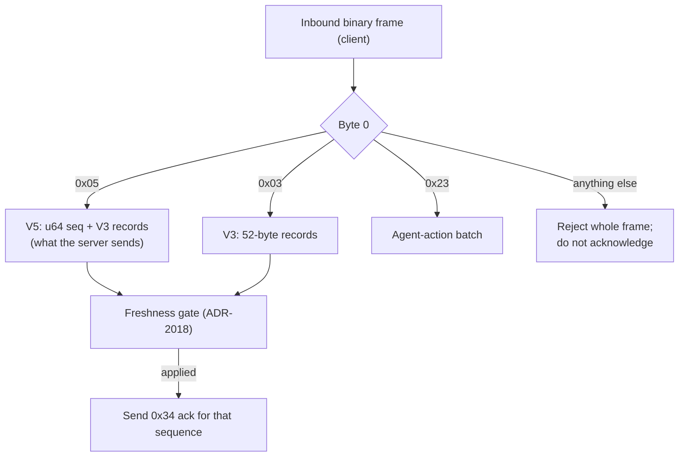

# Binary Protocol Reference

> [VisionClaw Docs](../README.md) · [Reference](README.md)

The binary protocol carries the high-rate payloads on the `/wss` WebSocket:
per-node position broadcasts, their acknowledgements, and agent-action beams.
Connection lifecycle, authentication, topology (`initialGraphLoad`) and every
control message travel as JSON text frames on the same socket — see
[WebSocket Protocol](websocket-protocol.md).

The byte layouts are owned by `crates/visionclaw-wire`: the server's encoder and
every client decoder (web, Godot XR, Codescape) are tested byte-for-byte against
its constructors and fixtures. The position format is frozen (ADR-2018,
compile-time size lock ADR-2057). Every multi-byte field is **little-endian**.

## Frames on `/wss`

Byte 0 of every binary frame says what it is. There is no generic header: each
frame type has its own fixed layout.

| Byte 0 | Frame | Direction | Layout | Size |
|--------|-------|-----------|--------|------|
| `0x05` | V5 position frame | S→C | `[0x05][u64 broadcast_seq][V3 record × N]` | `9 + 52N` |
| `0x03` | V3 position frame | S→C | `[0x03][V3 record × N]` | `1 + 52N` |
| `0x23` | Agent-action batch | S→C | `[0x23][u16 count]`, then `[u16 event_len][event]` × count | variable |
| `0x34` | Position acknowledgement | C→S | `[0x34][u64 sequence][u32 nodes_received][u64 timestamp_ms]` | 21 |
| `0x02` | Voice data | C→S | `[0x02][audio bytes]` | variable |

The server streams **V5**: each client gets its own ack-paced stream of chunks
(at most 2,500 nodes, `DEFAULT_STREAM_CHUNK_NODES`), and the next chunk is built
only after the client acknowledges the last one, or after a 500 ms acknowledgement
timeout (ADR-2141). Decoders accept V3 as well, since V5 is purely additive: strip
the version byte and the eight sequence bytes and the rest is byte-for-byte a V3
body. The server accepts only `0x34` and `0x02` from clients
(`src/utils/binary_protocol.rs`, `decode_message`); clients move nodes with JSON
drag messages, never binary position writes.



**Retired, not on the wire.** The V2 record (36 bytes, `0x02` as a position
version), the V4 delta (`0x04`, 20-byte `i16` deltas) and a magic-tagged
`BinaryV3Frame` (`0x56334630`) are gone from the server and from `crates/`. The
web decoder (`client/src/types/binaryProtocol.ts`) and the XR decoder reject a
`0x02`/`0x04` position frame whole, and the XR client does not acknowledge it, so
under ADR-2141 pacing a producer that switched format would stall that client at
the acknowledgement timeout rather than corrupt it. The web client's
`BinaryWebSocketProtocol.ts` still declares a six-byte "MessageType" envelope
(`0x01`, `0x10`–`0x54`, `0xFF`); the server neither sends nor parses it.

**Other sockets.** Avatar poses travel on `/ws/presence`, not `/wss`, as opcode
`0x43` (`crates/visionclaw-xr-presence/src/wire.rs`, `OPCODE_AVATAR_POSE`).

---

## Position records

Receivers dispatch on the version byte and require the record bytes to be a
whole multiple of 52; a V5 frame cut inside its sequence, or any misaligned
body, is rejected whole.

### V3 record — 52 bytes (frozen)

Every position frame carries full state: position, velocity and the analytics
tail (ADR-031), with no separate per-frame analytics message.

| Offset | Field | Type | Description |
|--------|-------|------|-------------|
| `0` | Node ID | `u32` | Bits 0–25 ID, bits 26–31 type flags (below) |
| `4` | Position X | `f32` | World-space coordinate |
| `8` | Position Y | `f32` | World-space coordinate |
| `12` | Position Z | `f32` | World-space coordinate |
| `16` | Velocity X | `f32` | Physics velocity (units/s) |
| `20` | Velocity Y | `f32` | Physics velocity |
| `24` | Velocity Z | `f32` | Physics velocity |
| `28` | SSSP distance | `f32` | Shortest-path distance; `f32::INFINITY` when unset (the stream currently always sends unset) |
| `32` | SSSP parent | `i32` | Parent in the SSSP tree; `-1` when none |
| `36` | Cluster ID | `u32` | K-means assignment; `0` = unassigned |
| `40` | Anomaly score | `f32` | Local Outlier Factor; `0.0` normal, `1.0` anomaly |
| `44` | Community ID | `u32` | Louvain community; `0` = unassigned |
| `48` | Centrality | `f32` | Normalised PageRank (ADR-031 D2) |

`NODE_RECORD_BYTES = 52` (`visionclaw-wire`; `WIRE_V3_ITEM_SIZE` on the server,
locked at compile time by ADR-2057).

Analytics values change at recompute cadence (~0.1–1 Hz); consumers treat the
tail as slowly varying. Each record carries position, velocity **and** the
analytics tail — there is no separate per-frame analytics message.

### V5 wrapper — sequenced V3 body

Protocol **V5** (`0x05`) wraps a V3 body with an 8-byte broadcast sequence number
so a receiver can detect stale or reordered position frames and acknowledge each
one by name. It is a pure framing wrapper — the node records are byte-for-byte V3.

```text
[u8 version = 0x05][u64 broadcast_seq LE][ V3 node records — N × 52 bytes ]
```

Decoders dispatch on the version byte, read the 8-byte sequence, and decode the
remaining bytes as a V3 record array (`visionclaw-wire`: `v5_frame`,
`v5_sequence_of`, `V5_SEQ_BYTES = 8`). The sequence feeds the consumer's
freshness gate (ADR-2018), which drops a frame older than the newest applied one
after a reorder or a reconnect to a restarted producer, and names the frame in
the `0x34` acknowledgement. This is the format the server streams.

### Node ID and type flags

The high bits of the `u32` node ID encode node type. The low 26 bits are the
sequential ID (`NEXT_NODE_ID` atomic counter, starting at 1).

| Constant | Value | Bit | Meaning |
|----------|-------|-----|---------|
| `AGENT_NODE_FLAG` | `0x80000000` | 31 | Agent node |
| `KNOWLEDGE_NODE_FLAG` | `0x40000000` | 30 | Knowledge node |
| `ONTOLOGY_TYPE_MASK` | `0x1C000000` | 26–28 | Ontology subtype mask |
| `ONTOLOGY_CLASS_FLAG` | `0x04000000` | 26 | OWL class |
| `ONTOLOGY_INDIVIDUAL_FLAG` | `0x08000000` | 27 | OWL individual |
| `ONTOLOGY_PROPERTY_FLAG` | `0x10000000` | 28 | OWL property |
| `NODE_ID_MASK` | `0x03FFFFFF` | 0–25 | Actual ID (`0 … 2²⁶−1`) |

Decode: `actualId = rawId & NODE_ID_MASK`. Test agent/knowledge with the
single-bit flags; test ontology subtype with `rawId & ONTOLOGY_TYPE_MASK`
against the exact subtype flag. See [Graph Schema](graph-schema.md) for the
node-type taxonomy.

---

## AGENT_ACTION (0x23) — 15-byte header

`AGENT_ACTION` visualises an ephemeral agent-to-node action (query, update,
create…). Each event has a 15-byte header and an optional variable payload.

| Offset | Field | Type | Description |
|--------|-------|------|-------------|
| `0` | Source agent ID | `u32` | Acting agent |
| `4` | Target node ID | `u32` | Target data node |
| `8` | Action type | `u8` | See action table below |
| `9` | Timestamp | `u32` | Event time, ms |
| `13` | Duration | `u16` | Animation duration hint, ms |
| `15…` | Payload | `u8[]` | Optional metadata (length = frame − 15) |

`AGENT_ACTION_HEADER_SIZE = 15`.

| Value | Action | Visual cue |
|-------|--------|-----------|
| `0` | Query | Blue `#3b82f6` |
| `1` | Update | Yellow `#eab308` |
| `2` | Create | Green `#22c55e` |
| `3` | Delete | Red `#ef4444` |
| `4` | Link | Purple `#a855f7` |
| `5` | Transform | Cyan `#06b6d4` |

On the wire the events always travel as a batch frame: `[0x23][u16 event_count]`
then, per event, `[u16 event_length][event bytes]`. The parse is a tolerant
prefix: complete events before a truncation are kept.

---

## Position acknowledgement

### BROADCAST_ACK (0x34) — 21 bytes

| Offset | Field | Type | Description |
|--------|-------|------|-------------|
| `0` | Frame type | `u8` | `0x34` |
| `1` | Sequence | `u64` | The V5 `broadcast_seq` of the frame just applied |
| `9` | Nodes received | `u32` | Records the client applied from it |
| `13` | Timestamp | `u64` | Client receive time, ms since the Unix epoch |

`BROADCAST_ACK_BYTES = 21`. A client acknowledges a frame only after applying
it; a stale or rejected frame is not acknowledged, so the server rebuilds that
chunk after its acknowledgement timeout. Acknowledgements are exempt from the
binary message rate limit.

---

## Validation rules

- Set `ws.binaryType = 'arraybuffer'` before the socket opens.
- Read all multi-byte fields little-endian.
- Position frames: dispatch on the version byte (`0x05` or `0x03`), reject any
  other version whole, and require the record bytes to be a multiple of 52.
- Pass V5 frames through a freshness gate before applying them, and acknowledge
  only what was applied.
- Reject records whose position or velocity is `NaN`/`Inf` (the XR client also
  drops coordinates beyond 10 km).

## See also

- [WebSocket Protocol](websocket-protocol.md) — handshake, JSON control frames, subscription lifecycle
- [Graph Schema](graph-schema.md) — node-type taxonomy and ID semantics
- [Physics GPU Engine](../explanation/physics-gpu-engine.md) — where position broadcasts originate
- [Performance Benchmarks](performance-benchmarks.md) — measured wire figures and how to benchmark
- [Protocol registry](../PROTOCOL-registry.md) — owner of the version bytes
- Governing records: [ADR-2018 — frozen 52-byte V3 record, V5 envelope](../adr/ADR-2018-frozen-52-byte-v3-record-v5-envelope.md) · [ADR-2024 — 26-bit wire node id](../adr/ADR-2024-wire-node-id-26bit.md) · [ADR-2057 — compile-time wire size lock](../adr/ADR-2057-compile-time-wire-size-lock.md) · [ADR-2141 — positions streamed per client until acknowledged](../adr/ADR-2141-positions-are-streamed-per-client-until-acknowledged.md) · [ADR-031 — GPU analytics](../archive/adr/ADR-031-gpu-analytics-correctness-and-wiring.md) · [ADR-061 — binary protocol unification (historical)](../archive/adr/ADR-061-binary-protocol-unification.md)
